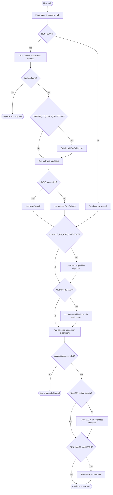
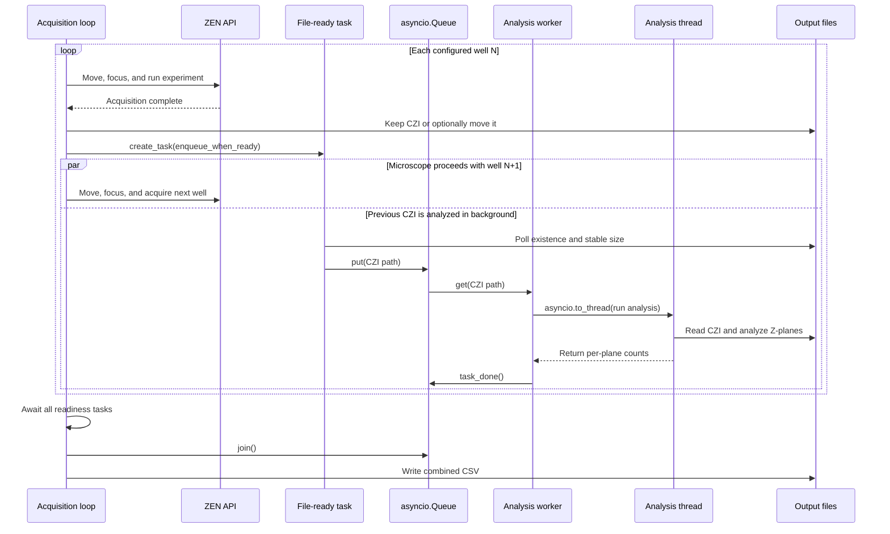

# CellDiscoverer 7 per-well workflow

This folder contains an asynchronous ZEN API example that visits selected wells on a CellDiscoverer 7.

- optionally finds focus and modifies a Z-stack experiment
- acquires a CZI file for each well
- counts segmented objects in every Z-plane.
- Acquisition and image analysis are decoupled through a background queue
- File-readiness polling and queue handling proceed while the microscope handles the next well
- CPU-bound CZI analysis runs in a worker thread so it does not block microscope-control coroutines
- Results from all successfully queued files are collected in one CSV file.

## Workflow overview

`cd7_workflow.py` is the entry point.

- It connects to ZEN and creates the required gRPC service stubs
- validates the requested wells against the detected sample carrier
- optionally optimizes the well order, loads the experiments
- caches ZEN's output folder
- creates a reusable experiment clone when requested
- starts the analysis queue, and then processes the wells
- Microscope operations remain sequential, while file monitoring and threaded analysis run concurrently.

The diagrams below show complementary views:

- the per-well acquisition decisions and the handoff from acquisition to background analysis.
- After the well loop, the workflow waits for readiness tasks and queued analyses, exports available results, and closes the ZEN API channel.

### Per-well acquisition

Optional steps are controlled by `workflow_config.py`.



ZEN chooses the image output directory; its API accepts an output name but no output path. The workflow queries that directory once and reuses it for every well. With `USE_ZEN_OUTPUT_FOLDER_DIRECTLY=True`, each CZI remains there and no post-acquisition
move is needed. When the option is false, `run_acquisition()` moves the CZI into the timestamped `EXPERIMENT_SUBFOLDER`. The filename format is `<well>_<timestamp>.czi`, for example `A1_20260914_143022.czi`.

## Acquisition and analysis data flow

The acquisition loop creates a readiness task for each CZI and immediately continues with the next well. Each task waits for the file to exist and for its size to remain unchanged for the configured settling period. It then puts the path on a shared
`asyncio.Queue`. A single background worker consumes queued paths, dispatches CZI processing with `asyncio.to_thread()`, and appends result dictionaries to a shared list.



### Concurrency model

The queue architecture allows work for well N to overlap microscope operations for well
N+1. File polling yields through `asyncio.sleep()`, queue operations cooperate with the
event loop, and `run_analysis()` sends blocking CZI loading and processing to
`asyncio.to_thread()`. The event-loop thread remains available for gRPC movement and
acquisition calls. One analysis worker processes CZI files in queue order; the workflow
does not run multiple analyses simultaneously.

## Image analysis

`image_analysis.py` reads the first channel of a grayscale CZI as a six-dimensional
array with axis order `(S, T, C, Z, Y, X)`. It fixes scene, time, and channel at index
`0`, then processes each Z-plane independently. RGB data is not supported by this
example.

1. Extract a two-dimensional `(Y, X)` plane.
2. Apply Otsu thresholding with `ArrayProcessor`.
3. Label connected components.
4. Remove objects of at most 100 pixels.
5. Measure `label`, `area`, `centroid`, and `bbox` properties.
6. Return the number of remaining objects for each Z-plane.

The current workflow records object counts only. The measured per-object property table
is produced internally but is not exported.

## Files

- `cd7_workflow.py`: Orchestrates connection, services, per-well acquisition, queue
  shutdown, and CSV export.
- `workflow_config.py`: Contains user-editable wells, experiments, optimization flags,
  paths, and timing values.
- `well_tasks.py`: Provides hardware operations, well ordering, cached output lookup,
  and reusable experiment updates.
- `analysis_queue.py`: Detects ready files, queues them, runs threaded analysis, and
  normalizes result rows.
- `image_analysis.py`: Performs per-Z-plane Otsu segmentation and object counting.
- `test_image_analysis.py`: Runs image analysis without microscope hardware using
  `Z=7.czi`.
- `test_well_order.py`: Verifies nearest-neighbor routing, stable tie-breaking,
  duplicate handling, input immutability, and invalid-well rejection.
- `Z=7.czi`: Local sample data used by the analysis test script.

The workflow also imports `ArrayProcessor` from the parent folder's
`processing_tools.py` module.

## Configuration

Edit `workflow_config.py` before running the workflow.

- `CONFIG_FILE`: ZEN API gRPC connection configuration. Relative paths start at
  `python_examples`.
- `WELLS`: Wells to acquire. The first entry remains the starting well when order
  optimization is enabled.
- `OPTIMIZE_WELL_ORDER`: Applies a nearest-neighbor heuristic to reduce stage travel.
- `RUN_SWAF`: Enables Definite Focus surface detection and software autofocus.
  When disabled, the workflow reads the current focus-drive Z position at each well
  instead of running either focus search.
- `SWAF_EXPERIMENT`: Experiment used by software autofocus and loaded only when SWAF
  is enabled.
- `ACQ_EXPERIMENT`: Base experiment loaded once for image acquisition.
- `CHANGE_TO_SWAF_OBJECTIVE`: Switches to `OBJECTIVE_POS_SWAF` before SWAF.
- `CHANGE_TO_ACQ_OBJECTIVE`: Switches to `OBJECTIVE_POS_ACQ` before acquisition.
- `OBJECTIVE_POS_SWAF` / `OBJECTIVE_POS_ACQ`: One-based objective changer positions.
- `MODIFY_ZSTACK`: Clones the acquisition experiment once and updates its Z-stack
  center, range, and interval for each well, then reads back and displays the updated
  Z-stack settings before acquisition.
- `ZSTACK_RANGE_M`: Total Z-stack range in metres, currently `20.0 * 1e-6`
  (20 micrometres).
- `ZSTACK_INTERVAL_M`: Slice-to-slice interval in metres, currently `3.0 * 1e-6`
  (3 micrometres).
- `USE_ZEN_OUTPUT_FOLDER_DIRECTLY`: Keeps CZI and CSV output in ZEN's cached output
  folder, avoiding file moves.
- `IMAGE_FOLDER`: Base folder for timestamped run folders when direct-output mode is
  disabled.
- `EXPERIMENT_SUBFOLDER`: Timestamped destination used only when direct-output mode is
  disabled. Its timestamp is generated when the configuration module is imported.
- `FILENAME_TIMESTAMP_FORMAT`: UTC timestamp format used for run folders and filenames.
- `RUN_IMAGE_ANALYSIS`: Enables queueing, segmentation, object counting, and CSV export.
- `POLL_INTERVAL_S`: Delay between file-readiness checks.
- `FILE_SETTLE_S`: Required duration of unchanged file size before queueing.
- `MOVE_SETTLE_S`: Pause after moving to a well.
- `SWAF_TIMEOUT_S`: Timeout supplied to software autofocus.

### Flag dependencies

- `MODIFY_ZSTACK=True` works with either value of `RUN_SWAF`. One acquisition clone
  is created before the well loop. With SWAF enabled, each well's stack is centered on
  the best-focus Z, or surface Z if SWAF fails. With SWAF disabled, it uses the current
  focus-drive Z read before the optional acquisition-objective switch; no per-well
  focus search is performed.
- `CHANGE_TO_SWAF_OBJECTIVE` takes effect only when `RUN_SWAF=True`.
  `CHANGE_TO_ACQ_OBJECTIVE` is independent of SWAF. Ensure each configured changer
  position matches the installed hardware.
- With `RUN_IMAGE_ANALYSIS=False`, CZI acquisition still runs, but no analysis CSV is
  created.

The current configuration has `RUN_SWAF=False` and `MODIFY_ZSTACK=True`, so each well's stack uses the current focus-drive Z with the configured range and interval. Edit `ZSTACK_RANGE_M` and `ZSTACK_INTERVAL_M` in `workflow_config.py` to change the
stack dimensions; both values are passed to the API in metres.

## Prerequisites

- A running ZEN instance with ZEN API enabled and reachable through the configured gRPC
  endpoint.
- Compatible `zen_api` and `zen_api_utils` packages and the example dependencies installed. The supplied
  `python_examples/python_env/env_zenapi.yml` or `env_smartmic.yml` environments include
  the broader example stack.
- The named acquisition and optional SWAF experiments available in ZEN.
- Correct objective changer positions and a compatible sample carrier.
- ZEN's image output path writable by the current process, and the configured destination
  folder accessible.

## Run

From the repository root in the configured Python environment:

```powershell
cd python_examples\cd7_workflow
python cd7_workflow.py
```

Two progress bars are displayed: acquisition progress by configured well and analysis
progress by completed queue job. Detailed operations and failures are also logged.

To test only the CZI analysis path without connecting to ZEN:

```powershell
cd python_examples\cd7_workflow
python test_image_analysis.py
```

`test_image_analysis.py` uses the included `Z=7.czi` and prints per-plane counts plus
minimum, maximum, and average counts.

The well-order optimizer can be tested without ZEN or microscope hardware:

```powershell
python -m unittest test_well_order.py
```

From the repository root, check linting and formatting with:

```powershell
python -m ruff check python_examples/cd7_workflow
python -m black --check python_examples/cd7_workflow
```

## Outputs

With `USE_ZEN_OUTPUT_FOLDER_DIRECTLY=True`, output is written to the image folder
configured in ZEN. With the option disabled, each run creates a folder named like
`Experiment_20260914_143022` beneath `IMAGE_FOLDER`. The selected output folder contains:

- One CZI file per successful acquisition.
- An `analysis_results_<timestamp>.csv` file when analysis is enabled and at least one
  result row exists.

CSV columns are:

| Column         | Meaning                                                      |
| -------------- | ------------------------------------------------------------ |
| `well_id`      | Well parsed from the first part of the CZI filename.         |
| `czi_file`     | CZI filename without its extension.                          |
| `z_plane`      | Zero-based Z-plane index, or `-1` for a failed analysis job. |
| `object_count` | Segmented object count, or `-1` for a failed analysis job.   |
| `status`       | `ok` or `error: <message>`.                                  |

Rows are sorted by `well_id` and `z_plane` before export.

## Failure behavior

- An invalid configured well aborts the workflow before any stage movement.
- A Definite Focus failure logs the gRPC error and skips that well.
- A SWAF failure falls back to the surface Z position and continues.
- An acquisition failure logs the gRPC error and skips analysis for that well.
- An image-analysis failure adds one error row to the CSV and allows the worker to
  continue with later files.
- An unexpected orchestration error aborts the workflow, but the ZEN API channel is
  still closed in `finally`.

File readiness polling has no timeout. If an expected CZI never appears, the final
`gather()` waits indefinitely. Cancel the process and inspect the ZEN output path and
acquisition logs in that case.
